<h1 align="center">🌅 Beautiful Day Counter for Horizon</h1>

<p align="center">
  <b>A clean, vanilla-style HUD that never lets you lose track of time:<br>
  day counter, clock and a colorful day/night bar, now as a native mod for Horizon.</b>
</p>

<p align="center">
  <a href="https://github.com/sonoFrangu/CustomHUD-Horizon/releases/latest"></a>
  <a href="https://playhorizon.dev/mods/customhud"></a>
  
  
  <a href="https://github.com/sonoFrangu/CustomHUD-Horizon/actions/workflows/ci.yml"></a>
  
  
  <a href="LICENSE"></a>
</p>

<p align="center">
  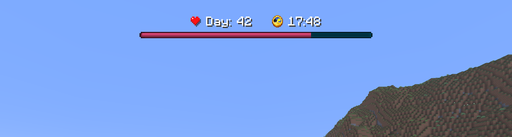
</p>

<p align="center">
  <a href="https://playhorizon.dev/mods/customhud"><b>Horizon mod page</b></a> ·
  <a href="https://github.com/sonoFrangu/CustomHUD-Horizon/releases/latest"><b>Download</b></a> ·
  <a href="https://modrinth.com/mod/beautiful-day-counter"><b>Java edition on Modrinth</b></a> ·
  <a href="https://github.com/sonoFrangu/CustomHUD"><b>Java source</b></a>
</p>

---

[Horizon](https://github.com/horizon-rust/horizon) is a rewrite of Minecraft Java Edition 26.3
in Rust. Fabric and NeoForge jars don't run on it, so this is a **native mod** built with
[horizon-mixins](https://github.com/horizon-rust/horizon-mixins) that the launcher compiles
into the game. It is a faithful port of the Java mod: same layout, same vanilla sprites,
same icons and the same settings screen.

## Contents

- [Features](#features)
- [Gallery](#gallery)
- [Installation](#installation)
- [Settings](#settings)
- [Building from source](#building-from-source)
- [Project layout](#project-layout)
- [License](#license)

## Features

| | |
|---|---|
| 📅 **Day counter** | The current day with an icon for your game mode: heart, hardcore heart, grass block, sword or ender eye. |
| 🕒 **Clock** | 24-hour or 12-hour time, with a clock icon that turns into a bed when you can sleep. |
| 🌗 **Day/night bar** | The vanilla bossbar sprite, filling through the day in four color themes. |
| ⏳ **Extras** | Countdown to night or day, moon phase, night marks on the bar and an optional background. |
| 🌧️ **Weather** <sup>new</sup> | A small pixel cloud after the clock with rain, snow or lightning, based on the weather and the biome you're in. |
| 🦇 **Phantom warning** <sup>new</sup> | After three days without sleep, a phantom membrane and the days since your last rest. |
| 🏆 **Milestones** | A rainbow counter, a golden apple or a totem and a level-up sound on milestone days. Choose classic milestones (50, 365, every 100) or every 10, 25, 50, 100, 250, 365, 500 or 1000 days. |
| 🎯 **Simple mode** | Just "Day: N", anywhere on screen. Set it in percent or drag it with the mouse. |
| 📐 **Placement** | Scale 75 to 150%, opacity, top or bottom, fine offsets. Vanilla bossbars move below the HUD. |
| 🌌 **Nether and End** | Show the Overworld time, `??:??`, or hide the HUD. |
| 🌍 **6 languages** | English, Italian, German, Spanish, French and Portuguese. |

## Gallery

### Through the day

The bar changes color as the day goes on: dawn, morning, noon, sunset and night.

<p align="center">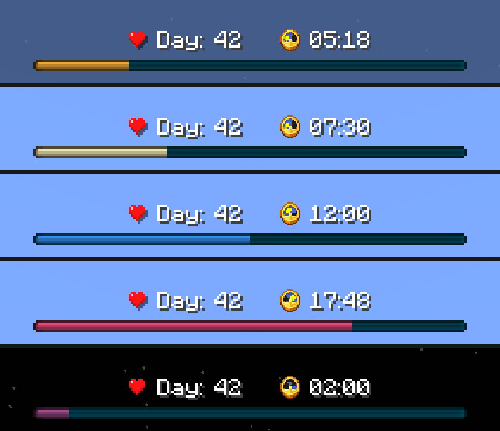</p>

### New in 1.8.0: weather and phantom warning

<table>
  <tr>
    <td align="center" width="50%">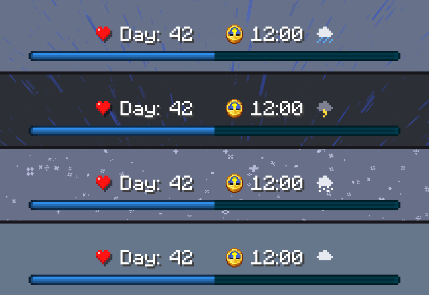<br><sub>Rain, thunder, snow, and a dry cloud where the biome has no rain</sub></td>
    <td align="center" width="50%">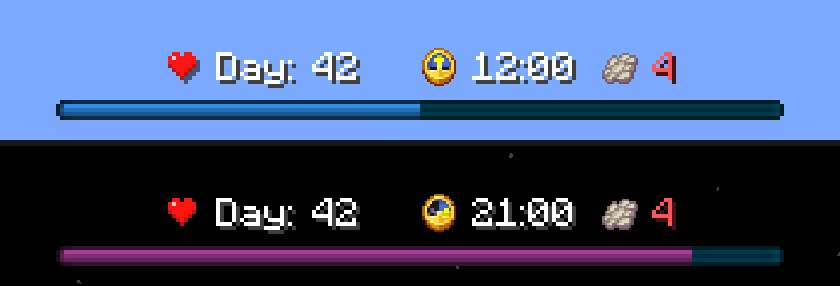<br><sub>Phantom warning after three sleepless days</sub></td>
  </tr>
</table>

<p align="center">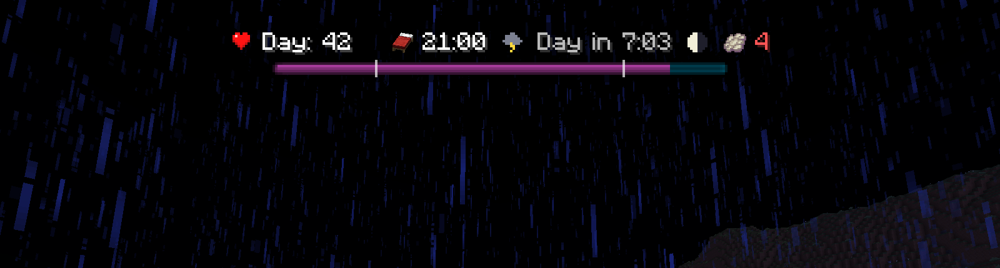<br><sub>Everything turned on, at night</sub></p>

### Themes, game modes and milestones

<table>
  <tr>
    <td align="center" width="50%">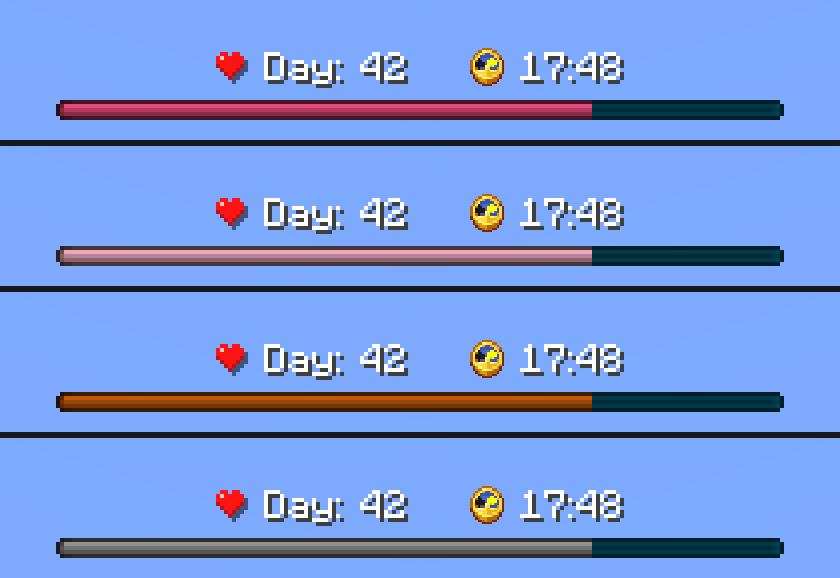<br><sub>Classic, Pastel, Colorblind and Mono</sub></td>
    <td align="center" width="50%">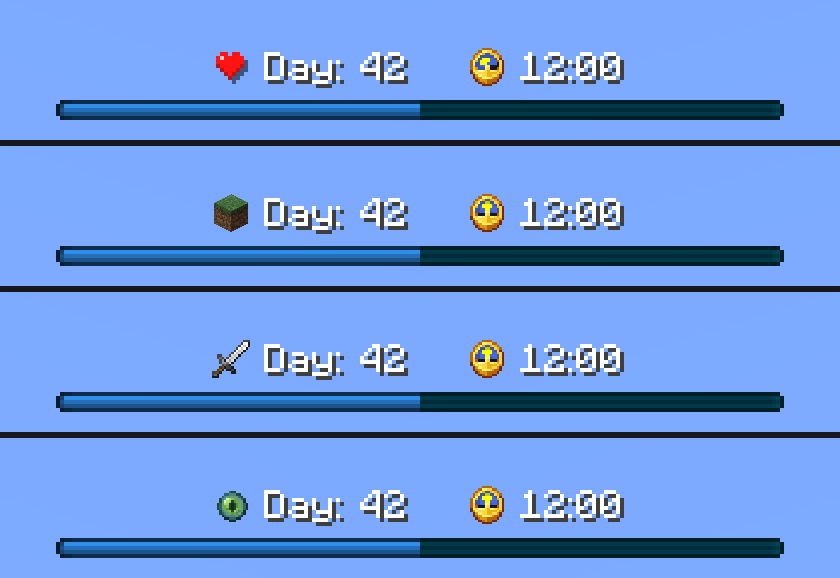<br><sub>Survival, creative, adventure and spectator</sub></td>
  </tr>
  <tr>
    <td align="center">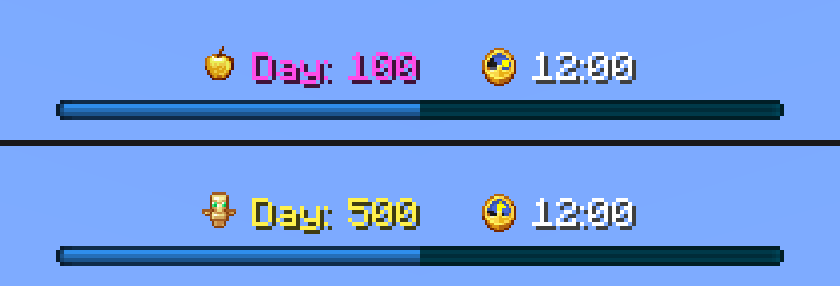<br><sub>Milestones: golden apple, then a totem from day 500</sub></td>
    <td align="center">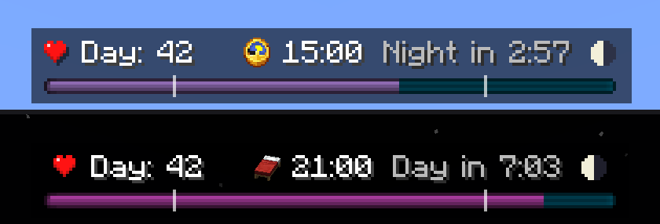<br><sub>Countdown, moon phase, night marks, background and the bed icon</sub></td>
  </tr>
  <tr>
    <td align="center">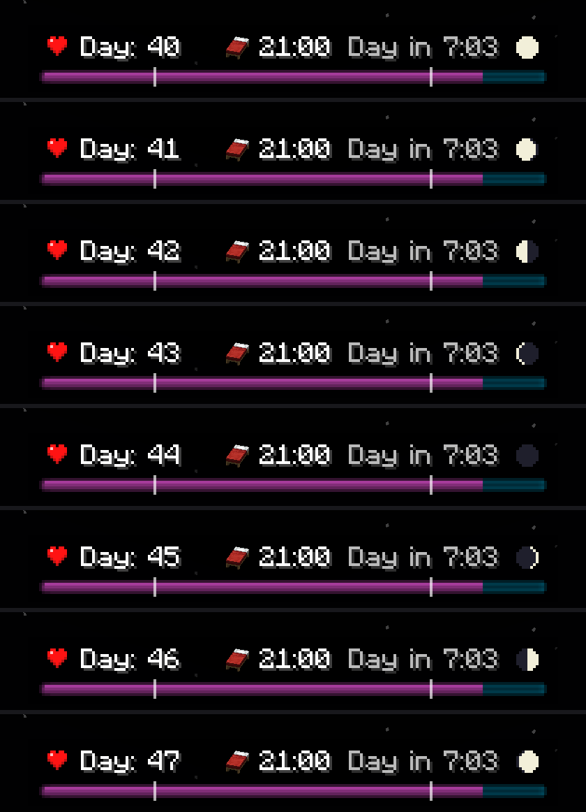<br><sub>All eight moon phases</sub></td>
    <td align="center">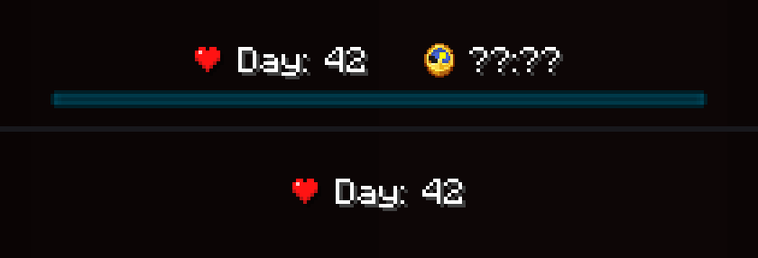<br><sub>Nether and End: <code>??:??</code>, or just the day</sub></td>
  </tr>
</table>

### Make it yours

<table>
  <tr>
    <td align="center" width="50%">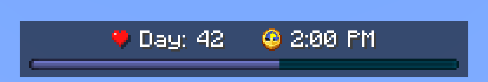<br><sub>Bigger, with background and a 12-hour clock</sub></td>
    <td align="center" width="50%"><br><sub>Smaller and see-through</sub></td>
  </tr>
  <tr>
    <td align="center">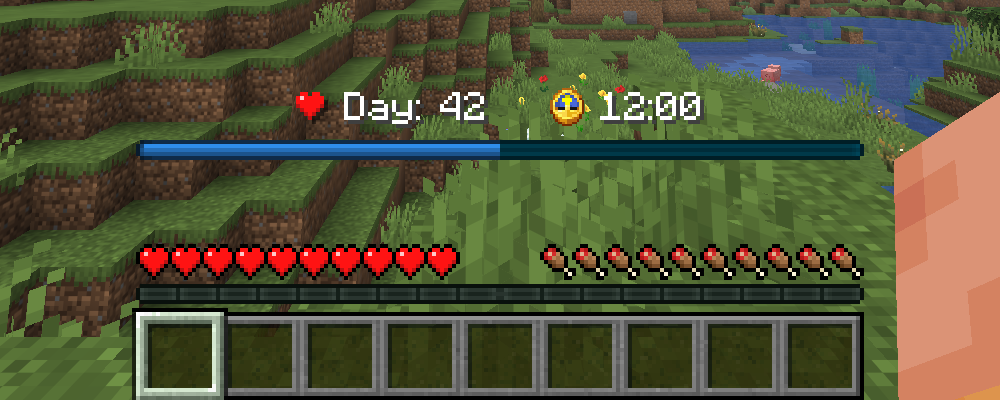<br><sub>At the bottom, just above health and hunger</sub></td>
    <td align="center">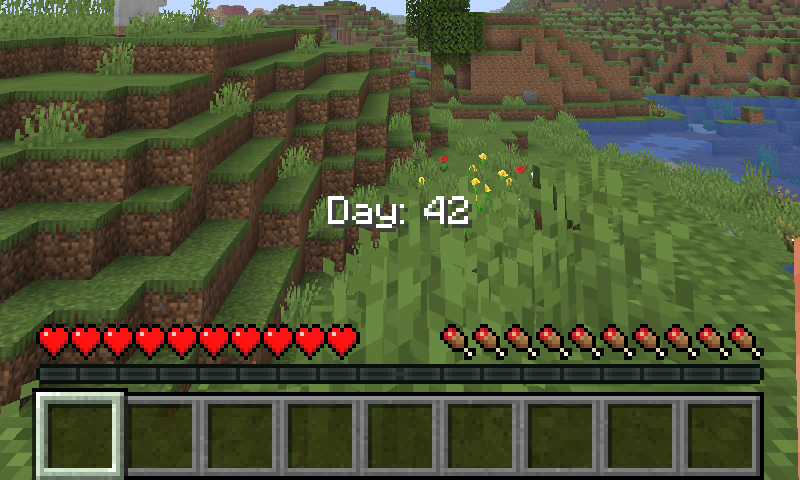<br><sub>Simple mode</sub></td>
  </tr>
</table>

### Settings

<table>
  <tr>
    <td align="center" width="62%">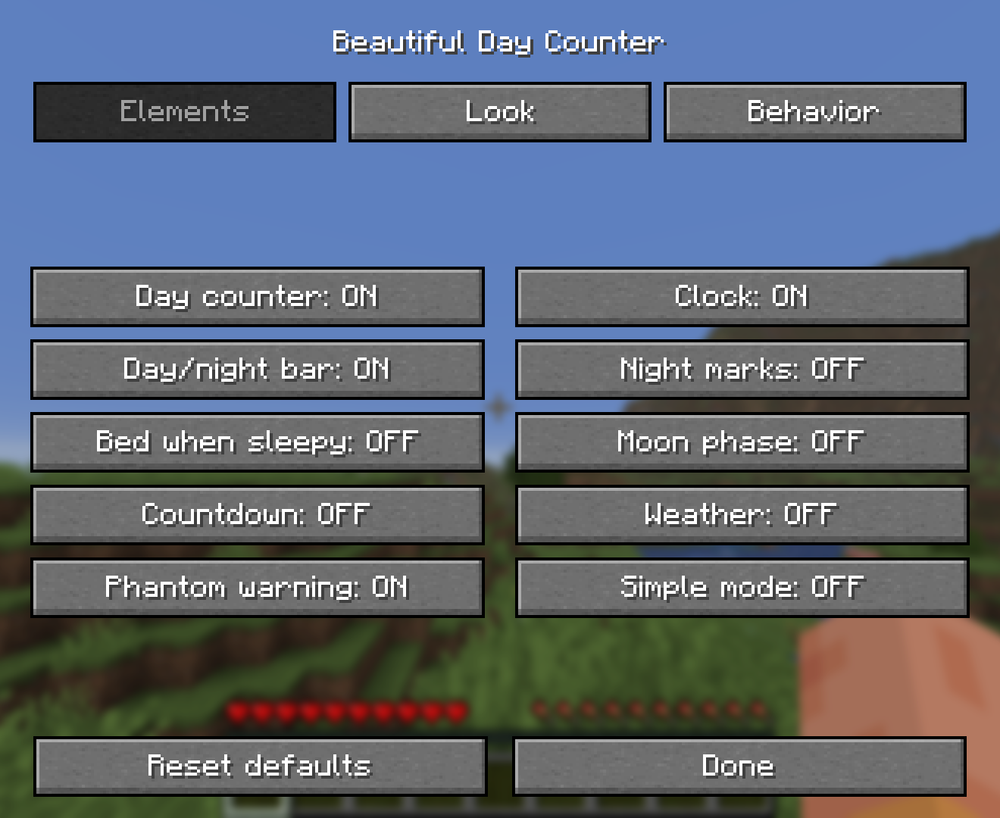<br><sub>The settings screen, with Elements, Look and Behavior tabs</sub></td>
    <td align="center" width="38%">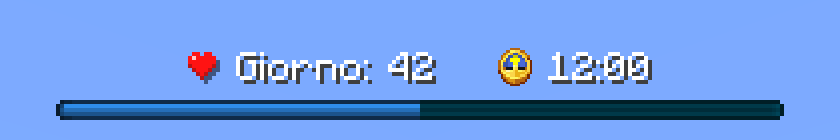<br><sub>Follows the game language</sub></td>
  </tr>
</table>

## Installation

1. Install the [Horizon launcher](https://playhorizon.dev).
2. Open **Mods**, find **Beautiful Day Counter** and install it.
3. Start the game. Native mods are compiled into Horizon, so the first start takes a few minutes.

The mod is client-side and works in singleplayer and on servers. On a server it asks for your
statistics every 10 seconds to keep the phantom warning up to date.

## Settings

Press **H** in game, or use the button on the mod's page in **Options > Mods**, where the key can
also be changed. Changes apply right away, no restart needed.

| Tab | Options |
|---|---|
| **Elements** | Day counter, clock, day/night bar, night marks, bed when sleepy, moon phase, countdown, weather, phantom warning, simple mode (with X/Y position and *Move with mouse*) |
| **Look** | Scale, opacity, background, bar theme |
| **Behavior** | 12/24-hour clock, top or bottom, X/Y offset, Nether and End, milestones, milestone sound, milestone every |

Settings are saved in `horizon-mods/.horizon-mod-data/customhud/config`, using the same field
names as the Java mod's `customhud.json`.

## Building from source

The simplest way is the Horizon launcher, which brings its own Rust toolchain:

```sh
horizon-launcher native-build mixins/customhud --trust-native-code
```

The logic (configuration, layout, translations, settings screen) is a plain Cargo library with
its own tests, so it can be tested without Horizon (Rust 1.95):

```sh
cargo test --workspace --locked
```

The scripts in `tools/` (stage, check and build against a Horizon checkout) come from the
[native mod template](https://github.com/horizon-rust/horizon-native-mod-template) and need
Linux and Python 3.12. `python3 tools/package.py` writes `target/customhud-<version>.hnmod`,
the source bundle published as a GitHub release and submitted to
[horizon-mods](https://github.com/horizon-rust/horizon-mods).

The supported Horizon and horizon-mixins revisions are pinned in
[`compatibility.json`](compatibility.json).

## Project layout

```text
mixins/customhud/
  horizon-mixin.toml   modules and HEAD hooks
  runtime.rs           the HUD and the mod's state
  config.rs            configuration: values, limits, reading and writing
  config_screen.rs     settings screen logic: widgets, labels, clicks, sliders
  text.rs              languages and translations
  screen.rs            game side: draws the HUD and the screen, handles input
  hud.rs               native_hud: draws the HUD
  key.rs               native_key: the key that opens the settings
  mods.rs              native_mods: the entry in Options > Mods
  settings.rs          native_settings: the button that opens the settings
  settings_click.rs    native_settings_click
  dialog.rs            draw_dialog_warning: draws the settings screen
  input.rs             window_event: mouse and keyboard for the settings screen
  boss_bars.rs         draw_boss_bars: finds where vanilla bossbars start
  extras.rs            draw_extras: moves them below the HUD
src/lib.rs             the standalone Cargo library over the same four logic files
compatibility.json     pinned Horizon and horizon-mixins revisions
docs/screenshots/      the images in this README
```

## License

[MIT](LICENSE) © SCARABOCCHIO100. Beautiful Day Counter is not affiliated with Mojang or Microsoft.
